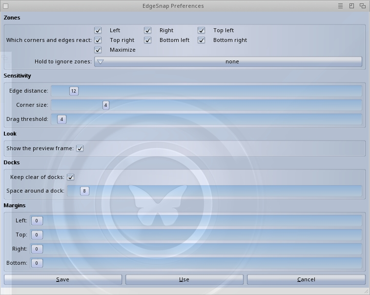

# EdgeSnap

**Author:** Michele Dipace <michele.dipace@kaffeine.net>
**License:** MIT (see [LICENSE](LICENSE))

Windows/macOS-style window snapping for AmigaOS 4.x, MorphOS and AROS
(x86_64, aarch64 and i386). Drag a window by its title bar until the
pointer touches a screen edge or corner: a frame shows where it will
land, and letting go fills that half or quarter of the screen. Docks
are kept clear, two windows side by side share a seam that resizes
both, and hotkeys and an ARexx port do the same from the keyboard and
from scripts.

Written in C89. No system patches: a commodity input handler plus public
Intuition calls only. The behaviour lives in `edgesnap.library`, and the
commodity is its first client: any program can open the library and ask
for the same things. I would like the library to be good enough for the
maintainers of these systems to adopt; nobody has adopted it so far.

*The preferences window on MorphOS (MUI), version 0.2. Since 0.5 it has
two pages, Snapping and Hotkeys. On AmigaOS 4 it is ReAction, on AROS
Zune, all built from one table of settings.*

## AmigaOS 3.x on the 68k

The classic Amiga has its own repository,
[EdgeSnap classic](https://github.com/kaffeine1/edgesnap-classic): the
same engine and library for AmigaOS 3.1 and later on any 68000 or
later, with or without a graphics card, with preferences in GadTools.
It follows this repository release by release, and its package is on
Aminet as `util/cdity/edgesnap.m68k-amigaos.lha`.

<!-- patreon-support:start -->
## Support development

EdgeSnap remains free and open source. You can [support my development work on Patreon](https://www.patreon.com/c/kaffeine1) to help fund testing, documentation and time spent improving it. No subscription is required to use the software, and public code, releases and articles remain available to everyone.

If you prefer a one-time contribution, you can [support my work on Ko-fi](https://ko-fi.com/kaffeine1).
<!-- patreon-support:end -->

## What it does

- drag a window so the **pointer** touches an edge or a corner: the
  frame previews the half, the quarter or the whole usable screen, and
  letting go snaps the window there;
- docks and panels, such as AmiDock and Ambient's panels, are detected
  and never covered;
- two windows side by side share their edge: press the seam and drag
  it, and both are resized;
- a snapped window dragged away from the edges gets its old size back,
  under the pointer;
- where windows may not leave the screen, pushing the mouse on against
  the edge brings the frame up ("Push against an edge", `PUSHPX`, 0
  turns it off);
- hotkeys, each of which can be changed on the Hotkeys page of the
  preferences: `ctrl alt` with the cursor keys for left, right,
  maximize and restore, `ctrl alt c` for the window's own size in the
  middle of the screen, `ctrl alt z` for a selector under the pointer,
  nine cells that are the map of the screen;
- an ARexx port, `EDGESNAP`: `SNAP`, `RESTORE`, `QUERY`, `SELECT`,
  `PREFS`, `ENABLE`, `DISABLE`, `VERSION`, `HELP` and `QUIT`, on the
  active window or on one named by a `TITLE` pattern;
- it is a commodity: it starts with the system, and Exchange enables,
  disables or removes it like any other;
- a preferences window in `SYS:Prefs`, native on each system; the same
  settings work as icon tooltypes, in `ENVARC:EdgeSnap.prefs` and on
  the command line (`EdgeSnap ZONES=halves EDGEPX=24`).

## Installing

The packages are on Aminet (`util/cdity`), OS4Depot, MorphOS-Storage,
the AROS Archives and the
[Releases](https://github.com/kaffeine1/edgesnap/releases) page:
`EdgeSnap-<version>.lha` for AmigaOS 4 and MorphOS, and one archive for
each AROS processor.

Unpack it and double-click Install. The installer recognises the
system and asks before doing anything. It puts the library in `LIBS:`
and the preferences in `SYS:Prefs`. On AmigaOS 4 and MorphOS the
commodity goes to `C:` with one line in `S:User-Startup`; on AROS it
goes to `SYS:WBStartup` with its icon. On AROS for the Raspberry Pi
and on 32-bit AROS, whose Installer copies nothing, Install does the
work itself.

Updating is installing again: the running copy is stopped and the new
library takes over without a reboot. `EdgeSnap.guide` in the package
explains the rest.

## Status

**0.52 (2026-11-09)** is the current release, with `edgesnap.library`
2.27. It is a beta, complete in what it does. It fixes a freeze on
AmigaOS 4 when one of two windows side by side was closed with its
close gadget. I tested it on real MorphOS hardware (Power Mac G5,
MorphOS 3.20) and under emulation on AmigaOS 4.1, MorphOS and AROS One
1.3 x86_64; the aarch64 and i386 builds come from the same sources.
What each release changed is on the
[Releases](https://github.com/kaffeine1/edgesnap/releases) page.

## Prior art

On the Amiga the closest piece of prior art is **GoSnap**, a commodity
for AmigaOS 3.1.4 and later that snaps a window dragged to an edge or
a corner of the screen. **ZapperNG** and **WinAction** arrange windows
from hotkeys. EdgeSnap has hotkeys too, but starts from the drag, and
puts the behaviour in a library other programs can call.

## For programmers

`edgesnap.library` places windows, says where a zone is, and finds and
moves the seam between two tiled windows. Since 2.10 it also serves
tiling window managers: client roles, work areas, layout groups with
gaps and margins, and the seams of a group named by tokens. The public
header is [include/edgesnap.h](include/edgesnap.h); every call says
from which revision it exists. Until 1.0 the interface is not frozen:
calls are only appended, but names and arguments may still change.

`esnaptest` ([tools/esnaptest.c](tools/esnaptest.c)), in each system's
drawer of the package, is a small client that drives the whole API.
[docs/DESIGN.md](docs/DESIGN.md) is the design: why a commodity and a
library, the input-handler rule, what each system taught me, and the
road to 1.0.

## Building

- Host tests, with any C compiler: `make -f Makefile.host test`.
- AmigaOS 4 and MorphOS: `scripts/build-os4.sh` and
  `scripts/build-morphos.sh`, in the cross-compiler containers
  (`colima start` first); the library, the preferences and the test
  client have their own `build-os4lib.sh`, `build-os4prefs.sh` and so
  on.
- AROS: `scripts/build-aros.sh` (x86_64, on a hosted AROS build
  machine, because a binary linked on the Mac does not start),
  `build-aros-aarch64.sh` and `build-aros-i386.sh`.
- `scripts/build-all.sh` rebuilds every lane from clean, and
  `scripts/make-release.sh` checks the versions and packs the archives.

For a quick test in the AmigaOS 4 VM, `scripts/make-test-iso.sh` builds
an ISO and `scripts/os4-cd.sh insert` puts it in the running VM's CD
drive. The ISO has no protection bits, so a program copied from it
needs `Protect +e`.

## Layout

- `core/`: pure C89, zero Amiga dependencies, unit-tested on the host:
  zone geometry, the drag and snap engine, the snap registry, docks,
  seams, configuration
- `include/`: the public headers, with `aros/`, `interfaces/` and
  `ppcinline/` for each system's callers
- `library/edgesnap_body.c`: the one implementation behind the public
  API; `library/os4`, `library/morphos` and `library/aros` wrap it as
  each system's library
- `commodity/edgesnap_cx.c`: the commodity, one source for every
  system: input in, preview frame and seam drawn, nothing decided
- `prefs/`: the preferences windows (`os4/` in ReAction, `morphos/` in
  MUI and Zune) and what they share
- `installer/`: `Install`, the Installer script for every system, and
  `Install-aros`, the Shell script for the AROS systems without a
  working Installer
- `tools/`: `esnaptest`, and `settings_guide`, which writes the guide's
  page of settings from the table in `core/config.c`
- `packaging/EdgeSnap.guide.in`: the manual
- `scripts/`: build, package, icons, channel readmes, test VMs

## Platform notes

- The CxCustom input handler runs in the input.device context: it only
  bumps counters and `Signal()`s the main task. All Intuition calls
  happen in the main task. Under `LockIBase()` we only read; the lock is
  dropped before any Intuition call, and a stored window pointer is
  never used without checking it against the screen's window list.
- MorphOS: commodities call a custom action through the 68k ABI, so the
  handler sits behind an `EmulLibEntry` gate; `-noixemul` is mandatory;
  the PPC stack is sized with `__stack`.
- AmigaOS 4: built with `__USE_INLINE__` and explicit `GetInterface()`
  for intuition and commodities.
- AROS: the library is generated from `library/aros/edgesnap.conf` with
  genmodule. On aarch64 it needs `-ffixed-x18 -fno-common`
  (`Makefile.aros-aarch64` says why).

## Thanks

- **Carlo Spadoni** drew the commodity and preferences icons, one set
  for each system. His pictures are shipped as he drew them:
  `scripts/make-aros-icons.py` and `scripts/make-system-icons.py` only
  add the type, the stack and the tooltypes.
- The testers on the AROSWorld forum found the black areas in Wanderer's
  drawers, the colour left along the seam and the traces of the preview
  frame on the NVIDIA Nouveau driver, each with a video or a log that
  made the cause findable.

## Reports

Problems go to
[this repository's issues](https://github.com/kaffeine1/edgesnap/issues):
please say the system, its version and what you did. For the 68k build,
use [EdgeSnap classic's issues](https://github.com/kaffeine1/edgesnap-classic/issues).
